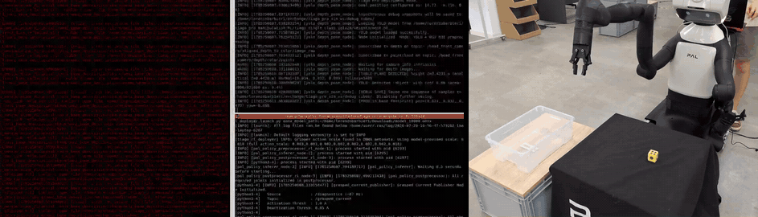
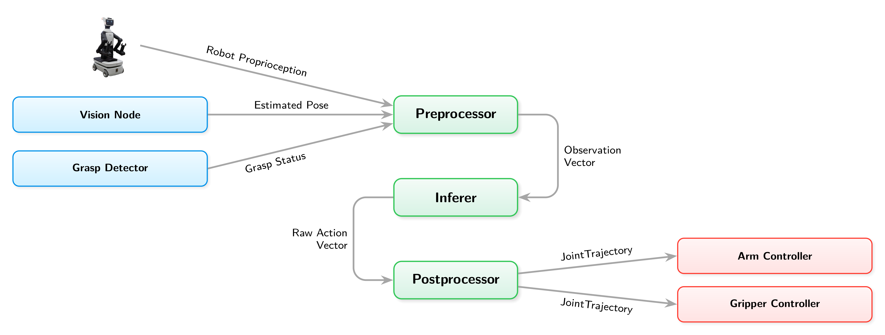
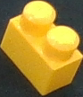
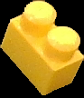
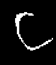
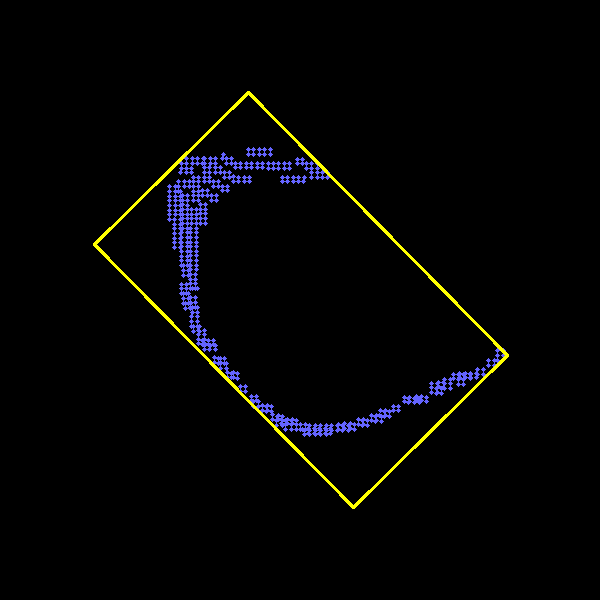
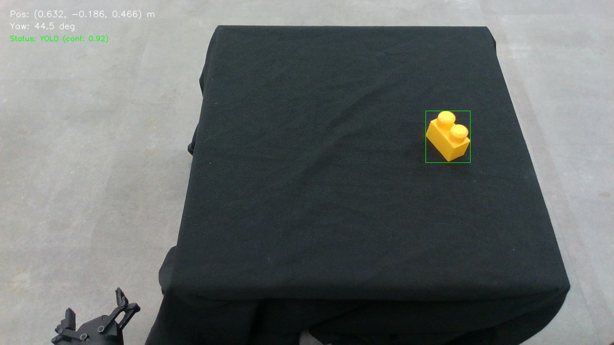

# Vision-Guided Reinforcement Learning for Pick-and-Place on TIAGo Pro

Code and material from my MSc thesis, **A Vision-Guided Reinforcement Learning Approach for Pick-and-Place Task Execution on the TIAGo Pro Platform** (Sapienza University of Rome, MSc in Artificial Intelligence and Robotics, 2026). The work was carried out during an internship at PAL Robotics.

The TIAGo Pro picks an object from a table, carries it to a container, releases it inside and returns for the next one. It uses only its onboard sensors: the head-mounted RGB-D camera and proprioception. Perception and control are kept separate:

- a **perception pipeline** estimates the 3D position and yaw of the object from the camera;
- a **PPO policy**, trained in simulation with [mjlab](https://github.com/mujocolab/mjlab), takes that estimate together with the robot state and commands the right arm and gripper;
- once a grasp is detected from the gripper motor current, the object pose is replaced by the end-effector pose, so the task keeps working while the arm hides the object from the camera.

The policy was trained only in simulation and deployed on the real robot without fine-tuning.

**[Read the thesis (PDF)](docs/thesis.pdf)**

## Demo

<p align="center">
  
</p>

A run on the real robot at 4× speed. Left: the robot's view in RViz, with the head-camera image and the 3D scene. Right: an external camera. In RViz, the green dot is the detected object, the orange dot means the object is grasped and the red dot is the release point.

Full-length videos at real speed (MP4 download): [RViz view](media/deployment_rviz.mp4?raw=true), [external view](media/deployment_external.mp4?raw=true).

## Where the code lives

| Component | Location |
| --- | --- |
| RL training: mjlab environment, observations, rewards, terminations, domain randomization, PPO configuration | [`pal-robotics/pal_mjlab`](https://github.com/pal-robotics/pal_mjlab/tree/lorenzo_manipulation_floor_release), branch `lorenzo_manipulation_floor_release`, in [`src/pal_mjlab/tasks/manipulation/`](https://github.com/pal-robotics/pal_mjlab/tree/lorenzo_manipulation_floor_release/src/pal_mjlab/tasks/manipulation) (task `Mjlab-Manipulation-Lift-Cube-Pal-Tiago-Pro-v0`) |
| Perception pipeline: vision node, grasp detector, detector training | This repository |
| Policy deployment nodes: preprocessor, inferer, postprocessor | Reserved within PAL Robotics, not published |

<p align="center">
  
</p>

The ROS 2 system on the robot has five nodes. The two perception nodes (blue) are in this repository. The three control nodes (green) build the observation vector, run the policy and convert its actions into joint trajectories for the arm and gripper controllers.

## Perception pipeline

[`src/yolo_depth_pose_hsv.py`](src/yolo_depth_pose_hsv.py) is a ROS 2 Python node that processes every colour frame from the head camera (Intel RealSense D435) and publishes the object pose in `base_footprint`. It works in four stages.

1. **Detection.** A YOLO26n detector, fine-tuned on a single-class dataset of cubes and other graspable objects, returns bounding boxes. The node keeps the most confident box above the threshold (0.45 by default) that covers less than 25% of the image.
2. **Colour segmentation.** The crop is converted to HSV. A reference colour is sampled from the central 60% of the box: circular mean for hue, medians for saturation and value. Pixels close enough to the reference on all three channels are kept, very grey or dark pixels are discarded, and a small morphological close/open cleans the mask.
3. **Depth filtering and back-projection.** The mask is applied to the aligned depth image. Invalid and out-of-range depths are dropped, and only pixels within 2.5 mm of the median depth survive. These are back-projected into 3D with the pinhole model.
4. **Pose and yaw.** The points are transformed to `base_footprint` and projected onto the horizontal plane, where a minimum-area rectangle is fitted. Its centre gives x and y; z is the midpoint between the highest and lowest point. The yaw is the angle of the rectangle edge closest to the x axis, in [-π/4, π/4], which is the range the policy was trained on.

<table>
  <tr>
    <td align="center"><br>Detected crop</td>
    <td align="center"><br>Colour mask</td>
    <td align="center"><br>Depth inliers</td>
    <td align="center"><br>Rectangle fit on the horizontal plane</td>
  </tr>
</table>

Before publishing, the estimate is post-processed:

- **Position** is smoothed with an exponential moving average (α = 0.4). When the estimate is within 8 cm of the end-effector, the raw value is used (α = 1).
- **Yaw** is collected for the first 3 s and then locked to the median of those samples for the rest of the run, since the object does not rotate on the table.
- **While grasped** (`/grasped_current` is true), the node publishes the pose of `gripper_right_grasping_link` instead of the camera estimate.
- **If detection fails**, the last estimate is published again.

<p align="center">
  
</p>

[`src/grasped_current_publisher.py`](src/grasped_current_publisher.py) is the grasp detector. The gripper has no tactile sensor, so the node reads the right-gripper actuator current from `/diagnostics` and the finger position from `/joint_states`. It publishes a latched `/grasped_current` flag with hysteresis: on above 1.0 A, off below 0.85 A. The flag is forced off when the fingers are almost closed (under 1.5 cm), which means nothing is between them.

### Topics

Vision node:

| | Topic | Type |
| --- | --- | --- |
| Sub | `/head_front_camera/color/image_raw` | `sensor_msgs/Image` |
| Sub | `/head_front_camera/color/camera_info` | `sensor_msgs/CameraInfo` |
| Sub | `/head_front_camera/aligned_depth_to_color/image_raw`, or `/head_front_camera/depth/image_rect_raw` with `--depth_gazebo` | `sensor_msgs/Image` |
| Sub | `/grasped_current` (optional) | `std_msgs/Bool` |
| Pub | `/predicted_object_pose` (also broadcast as TF frame `predicted_object_frame`) | `geometry_msgs/PoseStamped` |
| Pub | `/goal_position` (2 Hz) | `geometry_msgs/PoseStamped` |
| Pub | `/head_front_camera/color/image_with_yolo` (annotated image) | `sensor_msgs/Image` |
| Pub | `/predicted_object_marker`, `/fitted_rectangle_marker`, `/goal_marker`, `/ee_offset_marker` | `visualization_msgs/Marker` |

Grasp detector: subscribes to `/diagnostics` and `/joint_states`, publishes `/grasped_current` (`std_msgs/Bool`).

## Repository layout

```
├── src/
│   ├── yolo_depth_pose_hsv.py        # vision node
│   ├── filters.py                    # EMA filters for position and yaw
│   ├── grasped_current_publisher.py  # grasp detector from gripper current
│   ├── run_rl_start.py               # moves arms, gripper, head and torso to the start pose used in training
│   ├── spawn_scene.py                # spawns a table and a cube in front of the robot in Gazebo
│   └── rviz_setup.rviz               # RViz configuration for the topics above
├── tiago_single_class_yolo26/
│   └── weights/best.pt               # trained YOLO26n detector
├── utils/
│   ├── collect_dataset.py            # generates labelled detector images in Gazebo
│   ├── train_yolo.py                 # fine-tunes YOLO26n with extra blur and lighting augmentation
│   └── test_yolo_image.py            # runs the detector on a single image
├── docs/
│   ├── thesis.pdf
│   └── figures/
└── media/                            # demo videos
```

## Requirements

- ROS 2 Humble with `cv_bridge` and `tf2_ros`
- Python 3.10 with `ultralytics` (a release that includes YOLO26), `torch`, `opencv-python` and `numpy`
- For simulation: Gazebo Classic with `gazebo_ros`, and the TIAGo Pro simulation from [`pal-robotics/tiago_pro_simulation`](https://github.com/pal-robotics/tiago_pro_simulation)

The trained detector is included as [`tiago_single_class_yolo26/weights/best.pt`](tiago_single_class_yolo26/weights/best.pt), which is the vision node's default model path. To train your own, see [Training the detector](#training-the-detector).

## Usage

All commands are run from the repository root in a sourced ROS 2 environment.

### Simulation

```bash
ros2 launch tiago_pro_gazebo tiago_pro_gazebo.launch.py
python3 src/run_rl_start.py    # start pose: head tilted 45° down, right gripper open
python3 src/spawn_scene.py     # table and red cube in front of the robot
python3 src/yolo_depth_pose_hsv.py --depth_gazebo
rviz2 -d src/rviz_setup.rviz
```

Gripper–object contact in Gazebo is unreliable, so the simulation is useful for testing perception and reaching, not the full grasp-and-place cycle.

### Real robot

```bash
python3 src/run_rl_start.py
python3 src/grasped_current_publisher.py
python3 src/yolo_depth_pose_hsv.py \
  --pose_offset 0.0 0.0 0.0 \
  --goal_position 0.72 -0.716 0.60
```

`--pose_offset` adds a constant correction to the estimated position, which is useful to compensate for arm calibration errors. The pick-and-place policies were trained with goal positions around (0.72, -0.716, 0.60) m in `base_footprint`.

## Training the detector

1. **Generate synthetic images.** With Gazebo running, `python3 utils/collect_dataset.py` writes images and YOLO labels to `datasets/dataset_v2/` (1500 frames by default, one in five for validation). Each frame randomizes the head and torso pose and the size, colour, position and yaw of the cube; the table colour and height change every 15 frames. Labels are computed by projecting the corners of the cube, after it settles, into the camera image.
2. **Assemble the dataset.** Put the final single-class dataset in `datasets/dataset_merged/` with a `dataset.yaml`. The dataset used in the thesis combined the Gazebo images with three public collections of cubes and graspable objects, for 4,552 training and 888 validation images.
3. **Train.** `python3 utils/train_yolo.py` fine-tunes the COCO-pretrained `yolo26n.pt` and writes the results to `runs/detect/tiago_single_class_yolo26/`. On top of the Ultralytics augmentations (HSV jitter, rotation, scaling, translation, perspective, flips, mosaic, AugMix), a custom trainer applies Gaussian blur on the GPU to mimic head vibration, plus gamma and brightness/contrast jitter.
4. **Check.** `python3 utils/test_yolo_image.py --model runs/detect/tiago_single_class_yolo26/weights/best.pt --image frame.png --output result.jpg`

Validation metrics of the included detector, as reported in the thesis:

| Model | Precision | Recall | mAP<sub>50</sub> | mAP<sub>50-95</sub> |
| --- | :---: | :---: | :---: | :---: |
| YOLO26n | 98.48% | 98.46% | 99.37% | 82.24% |

mAP<sub>50-95</sub> is lower because it averages over stricter IoU thresholds, up to 0.95, where small offsets of the box edges already count as misses.

## Citation

```bibtex
@mastersthesis{barbieri2026vision,
  author = {Lorenzo Barbieri},
  title  = {A Vision-Guided Reinforcement Learning Approach for Pick-and-Place Task Execution on the {TIAGo Pro} Platform},
  school = {Sapienza University of Rome},
  type   = {{MSc} thesis},
  year   = {2026}
}
```

Advisor: Prof. Daniele Nardi. Co-advisor: Prof. Vincenzo Suriani.
